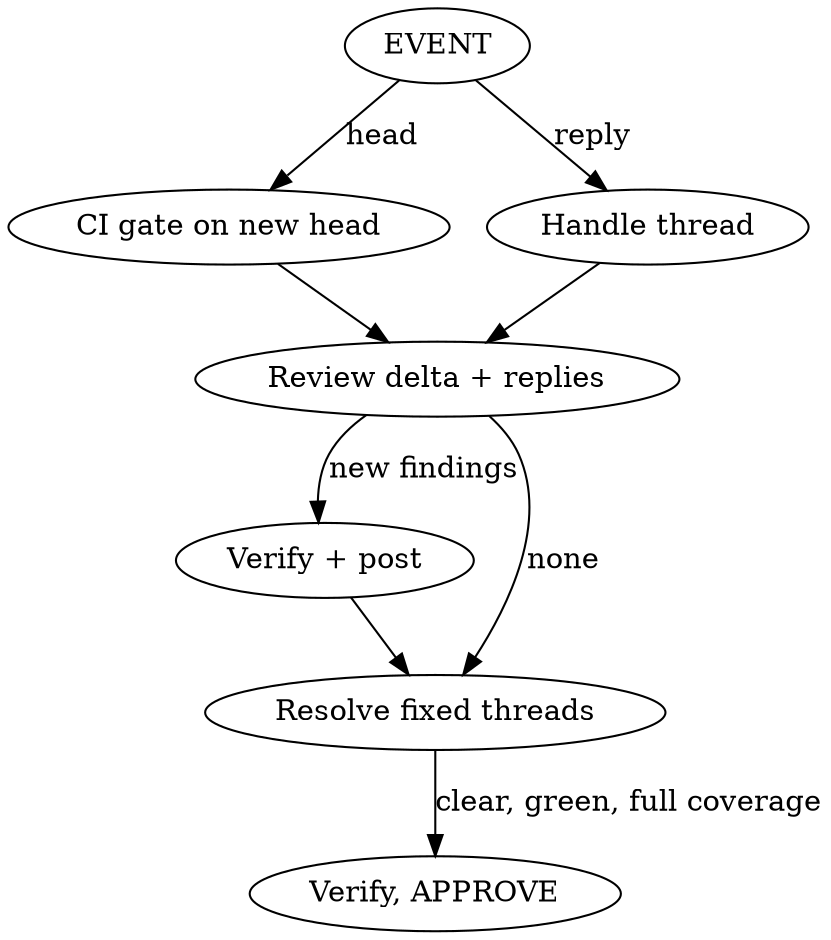

# Auto mode

Preflight, review, verify, then post the review (common.md) without asking. Then watch the PR until the operator says stop (skip the watcher if the operator said "no watcher" or "post once").

State: `lastReviewedSha`, your thread IDs, handled comment IDs.

## Watcher
Start `bash <skill-dir>/scripts/watch-pr.sh <owner/repo> <n> 60` under a Monitor (persistent). It prints one `EVENT` line per change and nothing otherwise, so idle waiting costs no tokens. Each line is one tick:

| Event | Do |
|---|---|
| `EVENT head <sha>` | New commits: CI gate on the new head, then re-review. |
| `EVENT comment <id> <login> reply_to=<id> <kind>` | A human wrote something: if it is on one of your threads, handle that thread; a top-level comment is data, read it. |
| `EVENT state CLOSED/MERGED` | Final summary, stop. |
| `EVENT error ...` | Tell the operator; stop (auth/rate limit/network). |

Always pass `--state <scratch>/watch-<n>.state` so a restart loses no events. The Monitor tool times out (about 30 min): when the watcher ends without `EVENT state`/`error`, start it again with the same `--state` file.

Where nothing can wake you (a subagent, no Monitor): don't hand-roll a poll loop. Call `bash <skill-dir>/scripts/watch-pr.sh <repo> <n> 30 --state <file> --max 540` in the foreground (Bash timeout 600000); it returns on the first batch of events or `EVENT idle`; handle them, call again. Repeat until `EVENT state`.

Several events in quick succession: batch them into one tick. Last resort without either: a self-paced `/loop` (~5 min) running the same checks. Stop the watcher when the operator says stop.

## Tick
1. Re-review only `gh api repos/{o}/{r}/compare/<lastReviewedSha>...<head>` plus replies. Threads via GraphQL (REST lacks thread IDs and resolved state):
   ```
   gh api graphql -f query='query($o:String!,$r:String!,$n:Int!){repository(owner:$o,name:$r){pullRequest(number:$n){reviewThreads(first:100){nodes{id isResolved comments(first:50){nodes{databaseId author{login} body}}}}}}}' -f o=OWNER -f r=REPO -F n=NUM
   ```
   Resolve: `gh api graphql -f query='mutation($t:ID!){resolveReviewThread(input:{threadId:$t}){thread{isResolved}}}' -f t=THREAD_ID`
2. Per prior thread:
   - Fixed in the delta: reply "Resolved in <sha>", resolve.
   - Author disagrees: reconsider on the merits. Right: reply "Agreed, <reason>", resolve. Partly right: concede that part, state the narrower remaining defect, leave open. Wrong: reply with the specific reason. "Intentional"/"approved elsewhere" is not proof: ask for a code comment or test that documents it.
   - State severity once; don't re-assert it in later replies. Reply once per author reply. Same point repeated without new evidence: no further reply; tell the operator it is unresolved.
   - Replies and resolves need no verifier; only new findings do.
   - Unaddressed: leave it.
3. New findings: verify, post as a new review. Update `lastReviewedSha`.
4. Nothing new: stay silent. When the PR closes, post one final summary comment (raised, resolved, still open, disputed; marker appended).
5. All clear + CI green + full coverage + not own PR: verify, then `APPROVE`.


